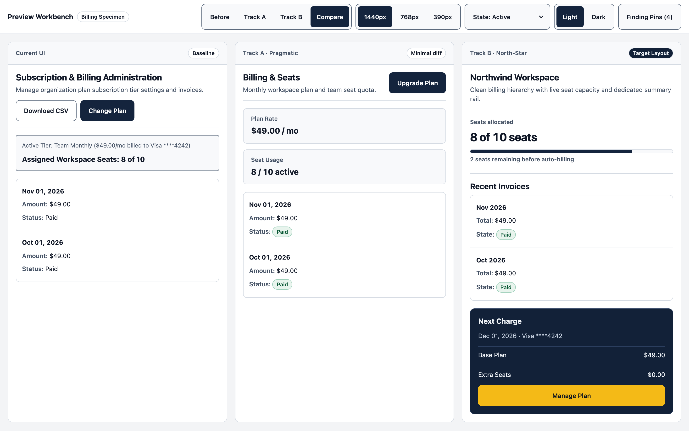

# DSAF — Design System & UX/UI Audit Framework (`v0.2.1`)

[](https://github.com/zintaen/dsaf/actions/workflows/ci.yml)
[](https://github.com/zintaen/dsaf/releases)
[](LICENSE)
[](package.json)

**DSAF** is a single, agent-native, clean-room audit framework that evaluates both **established design systems** and **live software products that do not yet have a design system** — pairing AI coding agents with deterministic Node ESM measurement scripts rather than static prose guesswork.

Written in international English as the canonical specification; the agent automatically mirrors the user's conversation language (for example Vietnamese or English) across Step 0 clarification briefs, reports, and drafts.

---

## Dual-Track Interactive Comparison Shell



Every UI refactor preview is built inside a self-contained single-file HTML comparison shell (`Before` · `Track A Pragmatic` · `Track B North-Star` · `Side-by-Side`, desktop/mobile viewports, Light/Dark switching, 4 UI states, and toggleable Finding Pins) and verified in headless Chromium. See [examples/sample-mode-c-report.md](examples/sample-mode-c-report.md) for a reproducible Mode C walkthrough.

---

## One Framework, Three Auto-Detected Topologies

| Topology Mode | Target | Core Rubric & Toolchain | Primary Deliverables |
|---|---|---|---|
| **`Mode S` — System Core** | Existing design system repository, Storybook, or token package | `DS01–DS12` (`25` core DSAF anchors), `audit-tokens.mjs` (W3C DTCG + Light/Dark contrast), `audit-runtime.mjs --storybook`, `L0–L5` maturity ladder with 3-band anti-prose cap (`prose <= 40%`) | 5-file audit dossier or `ANALYZED_DESIGN_REPORT.md`, `scores.json` (`dsaf-scores/2`), `audit-diff` regression baseline, `SCAN → Review → FIX` backlog |
| **`Mode C` — Conformance & Drift** | Product consuming a design system or token package | Usability `U01–U18` + Visual `V01–V11` + Conformance `DS07–DS09`, token compliance %, hardcoded & Tailwind arbitrary drift, `!important` overrides, live DOM `N-of-1` clustering, Figma MCP / Code Connect 3-vertex SOP | Multi-file audit dossier, Before/After Dual-Track `draft/*.html`, Drift & `N-of-1` remediation plan, executable lint/CI guardrails (`+SG`) |
| **`Mode P` — Product UX/UI (No DS)** | Live web app, mobile web, or prototype with no formal DS | Usability `U01–U18` (`5-axis` personas, 7-state edge matrix, 4 Data Mutation Tiers) + Visual `V01–V11` (WCAG 2.2 AA, APCA `Lc`, keyboard map, anti-"AI slop") | Multi-file dossier, Dual-Track `Pragmatic` vs `North-Star` `draft/*.html`, optional **Starter Design System Spec** + starter DTCG tokens + CI guardrails (`+SG`) |

---

## Quick Start

### 1. Verify the Framework (`Node >= 20`, zero required npm install)

```bash
git clone https://github.com/zintaen/dsaf.git
cd dsaf
npm test
```

*(Install Playwright in your target project or globally only if you want `audit-runtime.mjs` to drive headless Chromium for live browser / `draft/*.html` verification; all static scripts, token/drift scanners, guardrail generators, scorecard validators, diff gates, and pure-JS self-tests run with zero external dependencies.)*

### 2. Run the Single-Entry `dsaf` CLI (`bin/dsaf.mjs`)

```bash
node bin/dsaf.mjs help
node bin/dsaf.mjs recon ./your-app
node bin/dsaf.mjs tokens ./your-app
node bin/dsaf.mjs figma-diff --figma ./figma-vars.json --tokens ./your-app [--prefix --sds-]
node bin/dsaf.mjs runtime --storybook ./storybook-static/index.json
node bin/dsaf.mjs guardrails --out ./your-app/.dsaf-guardrails --stack tailwind
```

> **Practical runtime & guardrail tips:**
> - **Live Playwright resolution (`dsaf runtime`):** If `dsaf` is invoked outside the audited repo, set `NODE_PATH=./node_modules` (and `PLAYWRIGHT_CHROMIUM_EXECUTABLE_PATH` if using a pre-installed browser shell) so `playwright` resolves cleanly.
> - **`+SG` gate targets & env caps (`check-design-discipline.mjs`):** Accepts either a directory (`app`, `src`) or a single file (`app/globals.css`). Configure budgets with `DSAF_MAX_HARDCODED_COLORS`, `DSAF_MAX_IMPORTANT`, `DSAF_MAX_TW_ARBITRARY`, plus optional `DSAF_MAX_SVG_COLORS` and `DSAF_MAX_SWATCH_COLORS`.

Or install/link via `npm link` (or `npx dsaf` once published to npm — `package.json` configures a strict `"files"` whitelist excluding maintainer-only `evolve/`) to invoke `dsaf <command>` anywhere (`recon`, `tokens`, `figma-diff`, `runtime`, `scorecard`, `diff`, `guardrails`, `integrity`, `verify`, `mine`, `sync`, `version`).

### 3. Install `dsaf` (and Optional Maintainer `dsaf-evolve`) into AI Coding Agents

```bash
npm run sync:skills
```

Or copy [skill/](skill/) manually into your agent's skill directory (`~/.gemini/config/skills/dsaf`, `~/.agents/skills/dsaf`, `~/.claude/skills/dsaf`, or `~/.codex/skills/dsaf`). Never copy `evolve/` into user-facing production skills unless you are maintaining DSAF itself.

### 4. Invoke the Skill

```text
/dsaf https://your-app.example.com
/dsaf ./path/to/your-repo
/dsaf conformance ./apps/web
/dsaf system ./packages/design-system
/dsaf product --auto ./apps/web
/dsaf retro
```

Always start at **Step 0**: the agent runs a fast ~30-second Tier 0 read-only `recon.mjs` inspection first, then pauses ONCE with a compact Clarification Brief (`Mode · Scope · Viewports · Data Tier · Ambition · Depth/Regression`) showing concrete options, trade-offs, and evidence-backed recommendations in your language before editing anything or touching live state. Passing `--auto` without explicitly confirming a data tier strictly locks execution to **Tier 0 Read-Only** — even on `localhost`.

---

## Deterministic Node ESM Toolchain

| Command / Script | Purpose | Zero-Dep Core |
|---|---|---|
| `dsaf recon <target>` (`skill/scripts/recon.mjs`) | 30s read-only scan detecting stack, routes, Storybook, DTCG tokens, Figma Code Connect, cloud DB risk (`T2-Mock`), and recommended Mode `S/C/P` | Yes |
| `dsaf tokens <dir-or-json>` (`skill/scripts/audit-tokens.mjs`) | Validates W3C DTCG tokens (`$value`, `$type`, `{alias}`, `$ref`, cycles), Light/Dark mode parity & token contrast, CSS/Tailwind `@theme` + arbitrary/primitive drift, near-duplicate hex clusters, `!important`, and authored orphan variables | Yes |
| `dsaf figma-diff --figma <f> --tokens <t>` (`skill/scripts/audit-figma-diff.mjs`) | Automates 3-vertex `Designed <-> Defined <-> Shipped` comparison across Figma variables (`@collection` / `*_primitives`), CSS custom properties (`var()` aliases, dark `@media` preservation, `--prefix` auto-strip, `px`/`rem` & font stacks), Code Connect (`*.figma.*` & `*.figma.batch.*`), DTCG tokens, and runtime summaries | Yes |
| `dsaf runtime <draft-or-url>` (`skill/scripts/audit-runtime.mjs`) | Verifies Canonical Preview Shell (`preview-shell.html`), `keyboardMap` (tabbable count, `tabindex > 0`, unnamed controls), local/live `--storybook` reduced-motion, `--screenshot [--pins]`, canvas-rasterized `oklch`/`lab`/`light-dark`, `pixelBehind` contrast, APCA-W3 `Lc`, WCAG `3.00:1` UI borders, `>= 44.0px` mobile tap targets, `N-of-1` clusters, `LCP`/`CLS`, `axe-core`, and Kept Wiring diff | Pure-JS self-tests yes; live checks require Playwright |
| `dsaf scorecard --input <file>` (`skill/scripts/compute-scorecard.mjs`) | Deterministic validator & calculator (`dsaf-scores/2`) supporting `usability`, `visual`, and `system` rubrics, domain weight presets, Hard Floor caps, 3-band prose cap (`<= 40%`), and exact Before vs Track A vs Track B point deltas | Yes |
| `dsaf diff --baseline <a> --current <b>` (`skill/scripts/audit-diff.mjs`) | Enforces **No-Silent-Regression** (`D-RT`, `OVRD-*`, `UNRESOLVED`); exits `1` on unapproved score drops | Yes |
| `dsaf guardrails --out <dir>` (`skill/scripts/generate-guardrails.mjs`) | Emits runnable `check-design-discipline.mjs` (separating CSS/inline-style `#hex` & Tailwind arbitrary brackets from informational SVG/swatch colors), GitHub Actions `dsaf-regression-gate.yml`, and `AGENTS-dsaf-rules.md` (`+SG`) | Yes |
| `npm test` (`check-integrity.mjs` + `validate-isolation.mjs`) | Verifies markdown links, zero `evolve/` or host `/Users/` / `file:///` leaks, version parity, CLI entry, Canonical Shell contract, schema validation, and all script self-tests | Yes |

---

## Closed-Loop Evolution (`evolve/`)

DSAF separates **production auditing (`skill/`)** from **framework self-evolution (`evolve/`, `/dsaf-evolve`)** so live audits never leak benchmark ground truth or mutate specs mid-run:

1. **Field Retro (`retro`):** Logs strictly anonymized, domain-stripped friction signals (`false_positive`, `false_negative`, `ds_drift_signal`, `ambition_gap`, etc.) into `~/.dsaf/feedback-log.jsonl`.
2. **Corpus & Signal Mining (`npm run evolve:mine`):** Clusters field retro signals alongside dead/saturated criteria and artifact probe gaps mined from `evolve/fixtures/calibration/*.scores.json`.
3. **One Atomic Hypothesis + Blind A/B Gates:** Every rule change goes through blind Evaluator subagents and independent Graders against hard guardrails (`G1–G8`, `T1–T10`, `VG1–VG9`, `V3-1..6`, `DS-1..5`) before human promotion and `npm run sync:skills`.

---

## Repository Layout

```text
dsaf/
├── bin/
│   └── dsaf.mjs            # Single-entry `dsaf` CLI wrapper
├── docs/
│   └── assets/             # Showcase visuals rendered from canonical shell
├── examples/
│   └── sample-mode-c-report.md
├── skill/                  # Portable Tier 1 production agent skill (no evolve/ files)
│   ├── SKILL.md
│   ├── references/         # Progressive-loaded SOPs (Step 0, Modes S/C/P, Shell, Retro)
│   ├── resources/          # Canonical Before/Track A/Track B preview shell HTML
│   └── scripts/            # 8 deterministic Node ESM CLI tools & self-tests
├── evolve/                 # Tier 2 maintainer-only closed-loop evolution workspace
│   ├── SKILL.md
│   ├── references/         # Evolution gates, blind eval SOP, feedback JSON Schema
│   ├── fixtures/           # Synthetic Mode S / C / P targets, calibration scores & retro log
│   ├── benchmark.md        # Empirical verification & A/B evolution log
│   └── scripts/            # Signal miner, isolation gate, local skill installer
├── package.json
├── CHANGELOG.md
├── LICENSE
└── README.md
```

---

## License

[MIT](LICENSE) — Copyright (c) 2026 Stephen Cheng.
