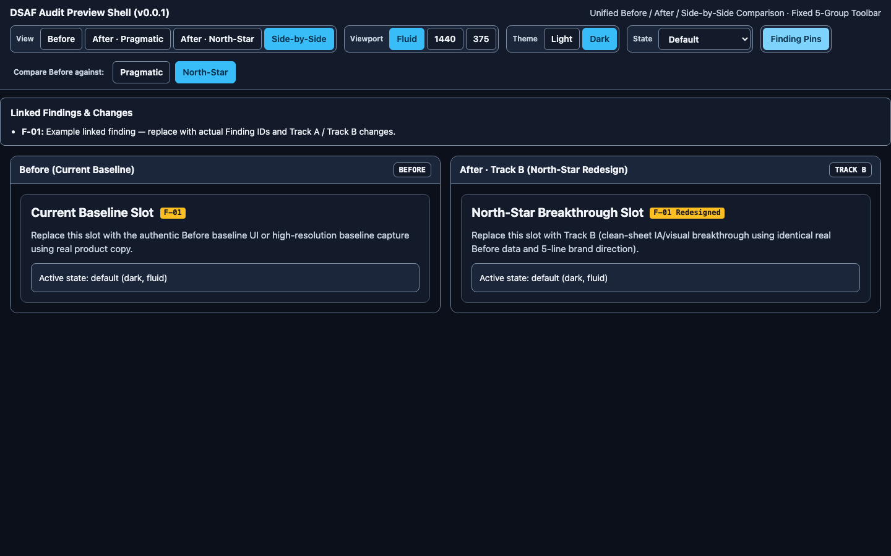

# Sample Mode C Conformance & Drift Report (`v0.1.0`)

Reproducible walkthrough against the synthetic fixture `evolve/fixtures/synthetic/mode-c-app` demonstrating **Step 0 Fast Recon**, deterministic token drift scanning, **2-vertex / 3-vertex Figma triangulation status**, weighted scorecard calculation (`dsaf-scores/2`), and executable `+SG` CI guardrails.

---

## 1. Step 0 — Read-Only Recon Summary

```bash
node bin/dsaf.mjs recon evolve/fixtures/synthetic/mode-c-app
```

- **Detected Topology & Maturity:** `Mode C — Product-on-DS Conformance & Drift` · `tier_2_baseline`
- **Frameworks & DS Dependencies:** `react` + `@radix-ui/react-dialog`, `acme-design-system`
- **Environment & Isolation Tier:** `T2` (`t2MockRequired: false`)
- **3-Vertex Triangulation Status:** `2-vertex Defined <-> Shipped verified; Designed (Figma MCP / Code Connect): not tested (not supplied)`

---

## 2. Codebase Token & Style Drift Baseline (`audit-tokens.mjs`)

```bash
node bin/dsaf.mjs tokens evolve/fixtures/synthetic/mode-c-app --json
```

| Metric | Measured Baseline | Notes |
|---|---|---|
| Files Scanned | `tokenJson=0, uiAndStyle=2` | Feature TSX + stylesheet only |
| Token Compliance Ratio | **`40.0%`** (`varRefs=2` vs `hardcodedColorHits=3`) | Semantic tokens bypassed in `src/styles.css` |
| Defined vs Used CSS Variables | `defined=4`, `used=2`, **`orphan=2`** | Unused `--accent-action`, `--unused-legacy-badge` |
| Near-Duplicate Hex Clusters | **1 cluster** (`["#1c4cd6", "#1e4ed9"]`) | Visual drift (`deltaRGB < 18`) around primary blue |
| `!important` Overrides | **1 override** (`src/styles.css`) | Specificity escalation fighting DS styles |
| Scoped Off-Grid Spacing / Radius | **2 hits** (`src/styles.css`) | Off-grid literals on padding/margin/gap/border-radius |
| Tailwind Arbitrary / Primitive Drift | `arbColor=0`, `arbPx=0`, `primitive=0` | Clean CSS-based project |

---

## 3. Deterministic Weighted Scorecard (`dsaf-scores/2`)

Generated programmatically via `node bin/dsaf.mjs scorecard --input <cal-c.json> --format markdown` and mirrored in `evolve/fixtures/calibration/mode-c-app.scores.json`:

| Pillar | Weight | Pts/Step (+1) | Before | Track A (Pragmatic) | Track B (North-Star) |
|---|---|---|---|---|---|
| **P1 — Foundations & Token Architecture** | 20% | +5.00 | 15.00 / 20 (75.0%) | 20.00 / 20 (100.0%) | 20.00 / 20 (100.0%) |
| **P2 — Component Architecture & Accessibility** | 25% | +4.17 | 20.83 / 25 (83.3%) | 25.00 / 25 (100.0%) | 25.00 / 25 (100.0%) |
| **P3 — Product Conformance & Drift** | 35% | +5.83 | 11.67 / 35 (33.3%) | 29.17 / 35 (83.3%) | 35.00 / 35 (100.0%) |
| **P4 — Governance, DX & AI Readiness** | 20% | +10.00 | 0.00 / 20 (0.0%) | 0.00 / 20 (0.0%) | 20.00 / 20 (100.0%) |
| **TOTAL (0–100)** | **100%** | — | **47.50** | **74.17** (`+26.67`) | **100.00** (`+52.50`) |
| **Grade / Maturity** | — | — | `L2 — Defined Baseline` | `L3 — Built & Shipped` | `L5 — Optimizing & Agent-Ready (External verification required for public L4/L5)` |

---

## 4. Prioritized Drift Findings

| Finding ID | Criterion | Severity | Confidence | Effort | Summary |
|---|---|---|---|---|---|---|
| `DRIFT-01` | `DS02`, `DS07` | **Major** — Drops token compliance to `40.0%` and fragments interactive brand blues | **High** — Observed directly via `audit-tokens.mjs` in `src/styles.css` | **Low (15m)** — Swap `#1c4cd6` / `#1e4ed9` cluster for `var(--accent-action)` | Replace hardcoded hex literals in `src/styles.css` with semantic DS tokens |
| `DRIFT-02` | `DS06`, `DS08` | **Major** — Specificity override (`!important`) and `2` off-grid spacing/radius literals break predictable composition | **High** — Measured directly in `src/styles.css` | **Low (15m)** — Remove `!important` and snap spacing to 4/8px DS tokens | Remove `!important` override and align spacing/radius rules to DS scale |
| `DRIFT-03` | `DS09` | **Minor** — `2` defined CSS variables remain unreferenced | **High** — `orphanCssVariableCount=2` reported by `audit-tokens.mjs` | **Low (10m)** — Wire `--accent-action` and prune dead `--unused-legacy-badge` | Reconcile orphan variables between DS contract and stylesheet |
| `DRIFT-04` | `DS11` | **Moderate** — Zero automated CI or AI-agent guardrails blocking future drift regressions | **High** — No discipline gate or agent rule file detected at `recon.mjs` | **Low (10m)** — Generate `+SG` pack and enable CI workflow | Install `.dsaf-guardrails/` discipline checks + `AGENTS-dsaf-rules.md` |

---

## 5. Dual-Track Interactive Comparison & Executable Guardrails

Every approved fix path renders inside DSAF's single-file comparison shell (`Before · Track A · Track B · Side-by-Side`) verified in Chromium (`0` overflow, APCA `Lc` verified, `0` `axe-core` violations):



After sign-off, generating and running DSAF's `+SG` guardrail pack against `evolve/fixtures/synthetic/mode-c-app/src`:

```bash
node bin/dsaf.mjs guardrails --out .dsaf-guardrails --stack css --mode C
node .dsaf-guardrails/check-design-discipline.mjs evolve/fixtures/synthetic/mode-c-app/src
```

Measured baseline failure before remediation (blocks regressions automatically in CI):

```text
DSAF_DISCIPLINE_SCAN: colors=3 (max 0), important=1 (max 0), twArbitrary=0
  - styles.css: colors=3 important=1 twArbitrary=0
DSAF_DISCIPLINE_GATE_FAILED
```
